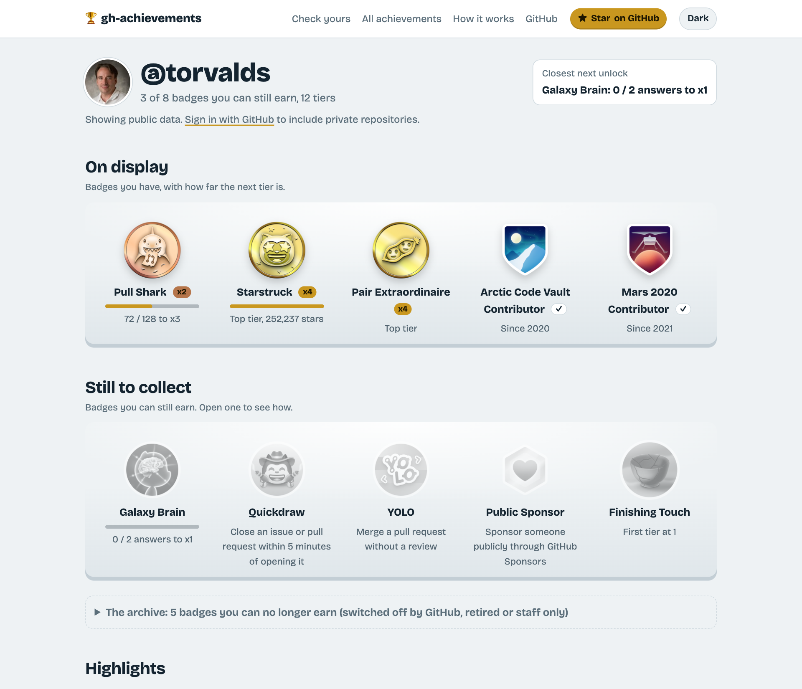

# gh-achievements: check your GitHub achievements progress

<!-- badges:start -->
<p align="center">
  <a href="https://gh-achievements.vercel.app/achievements/pull-shark/"></a>
  <a href="https://gh-achievements.vercel.app/achievements/starstruck/"></a>
  <a href="https://gh-achievements.vercel.app/achievements/pair-extraordinaire/"></a>
  <a href="https://gh-achievements.vercel.app/achievements/galaxy-brain/"></a>
  <a href="https://gh-achievements.vercel.app/achievements/quickdraw/"></a>
  <a href="https://gh-achievements.vercel.app/achievements/yolo/"></a>
  <a href="https://gh-achievements.vercel.app/achievements/public-sponsor/"></a>
  <a href="https://gh-achievements.vercel.app/achievements/finishing-touch/"></a>
</p>
<!-- badges:end -->

<p align="center"><strong>Your GitHub trophy case: every achievement, your tier and how far the next one is, verified against GitHub's own data.</strong></p>

<p align="center">
  <a href="https://gh-achievements.vercel.app/check/"></a>
</p>

<p align="center">
  <a href="https://gh-achievements.vercel.app/check/"><strong>gh-achievements.vercel.app/check</strong></a> · no install · or use the CLI below
</p>

<p align="center">
  <a href="https://gh-achievements.vercel.app/result?u=torvalds">
    <picture>
      <source media="(prefers-color-scheme: dark)" srcset="docs/screenshot-dark.png">
      
    </picture>
  </a>
</p>

[](https://github.com/nmloc/gh-achievements/releases)
[](https://github.com/nmloc/gh-achievements/actions/workflows/test.yml)
[](LICENSE)

## Two ways to check

| On the web | In your terminal |
|---|---|
| **[gh-achievements.vercel.app/check](https://gh-achievements.vercel.app/check/)** | `gh extension install nmloc/gh-achievements` then `gh achievements` |
| Type any username, or sign in with GitHub to include private repositories. The token is used for one check and revoked at once; nothing is stored. | Reuses your `gh auth login`, so it counts everything that login can see, including organizations that restrict third-party apps. |


## What it shows

- **Every badge, not just yours.** All 15 known achievements (8 earnable, 2 switched off by GitHub, 2 retired, 3 for GitHub staff) and 6 profile highlights such as Pro.
- **How far to the next tier.** Your count against the next threshold, such as `72 / 128 to x3` for Pull Shark.
- **Checked against GitHub.** Tiers, unlock dates and milestones come from GitHub's own badge history, and every number is labelled `official`, `calibrated` or `counted`.

## Install

You need the [GitHub CLI](https://cli.github.com/) (`brew install gh`, `winget install GitHub.cli`, or [another installer](https://github.com/cli/cli#installation)).

```bash
gh extension install nmloc/gh-achievements
```

Upgrade with `gh extension upgrade achievements`. Prebuilt binaries for macOS, Linux and Windows (amd64 and arm64) come from [Releases](https://github.com/nmloc/gh-achievements/releases), so no Go toolchain is needed.

## Usage

```bash
gh achievements              # the account you are signed in to with gh
gh achievements torvalds     # anyone's public profile
gh achievements --json       # machine-readable, for scripts
gh achievements --all        # also the archive, every highlight and each badge's notes
gh achievements --no-color   # plain text (NO_COLOR is honoured too)
```

Not signed in to gh? It still works with public data and tells you what a login would add.

## All GitHub achievements

<!-- catalog:start -->
### Earnable

You can still earn these.

| Badge | Achievement | How to earn it | Tiers |
|:-:|---|---|:-:|
|  | [Pull Shark](https://gh-achievements.vercel.app/achievements/pull-shark/) | Open pull requests that get merged | <table><tr><th>Default</th><th>Bronze</th><th>Silver</th><th>Gold</th></tr><tr><td align="center"></td><td align="center"></td><td align="center"></td><td align="center"></td></tr><tr><td align="center">2</td><td align="center">16</td><td align="center">128</td><td align="center">1024</td></tr></table> |
|  | [Starstruck](https://gh-achievements.vercel.app/achievements/starstruck/) | Create a repository that gets stars | <table><tr><th>Default</th><th>Bronze</th><th>Silver</th><th>Gold</th></tr><tr><td align="center"></td><td align="center"></td><td align="center"></td><td align="center"></td></tr><tr><td align="center">16</td><td align="center">128</td><td align="center">512</td><td align="center">4096</td></tr></table> |
|  | [Pair Extraordinaire](https://gh-achievements.vercel.app/achievements/pair-extraordinaire/) | Coauthor commits on merged pull requests | <table><tr><th>Default</th><th>Bronze</th><th>Silver</th><th>Gold</th></tr><tr><td align="center"></td><td align="center"></td><td align="center"></td><td align="center"></td></tr><tr><td align="center">1</td><td align="center">10</td><td align="center">24</td><td align="center">48</td></tr></table> |
|  | [Galaxy Brain](https://gh-achievements.vercel.app/achievements/galaxy-brain/) | Have discussion answers accepted | <table><tr><th>Default</th><th>Bronze</th><th>Silver</th><th>Gold</th></tr><tr><td align="center"></td><td align="center"></td><td align="center"></td><td align="center"></td></tr><tr><td align="center">2</td><td align="center">8</td><td align="center">16</td><td align="center">32</td></tr></table> |
|  | [Quickdraw](https://gh-achievements.vercel.app/achievements/quickdraw/) | Close an issue or pull request within 5 minutes of opening it | <table><tr><th>Default</th></tr><tr><td align="center"></td></tr><tr><td align="center">1</td></tr></table> |
|  | [YOLO](https://gh-achievements.vercel.app/achievements/yolo/) | Merge a pull request without a review | <table><tr><th>Default</th></tr><tr><td align="center"></td></tr><tr><td align="center">1</td></tr></table> |
|  | [Public Sponsor](https://gh-achievements.vercel.app/achievements/public-sponsor/) | Sponsor someone publicly through GitHub Sponsors | <table><tr><th>Default</th></tr><tr><td align="center"></td></tr><tr><td align="center">1</td></tr></table> |
|  | [Finishing Touch](https://gh-achievements.vercel.app/achievements/finishing-touch/) | Get pull requests that improve GitHub's UI quality merged | <table><tr><th>Default</th><th>Bronze</th><th>Silver</th><th>Gold</th></tr><tr><td align="center"></td><td align="center"></td><td align="center"></td><td align="center"></td></tr><tr><td align="center">1</td><td align="center">4</td><td align="center">16</td><td align="center">32</td></tr></table> |

### Switched off by GitHub

GitHub tested these and switched them off; nobody can earn them now.

| Badge | Achievement | How to earn it | Tiers |
|:-:|---|---|:-:|
|  | [Heart On Your Sleeve](https://gh-achievements.vercel.app/achievements/heart-on-your-sleeve/) | React to something on GitHub with a ❤️ emoji | <table><tr><th>Default</th><th>Bronze</th><th>Silver</th><th>Gold</th></tr><tr><td align="center"></td><td align="center"></td><td align="center"></td><td align="center"></td></tr><tr><td align="center">?</td><td align="center">16</td><td align="center">128</td><td align="center">?</td></tr></table> |
|  | [Open Sourcerer](https://gh-achievements.vercel.app/achievements/open-sourcerer/) | Have pull requests merged in several public repositories | <table><tr><th>Default</th><th>Bronze</th><th>Silver</th><th>Gold</th></tr><tr><td align="center"></td><td align="center"></td><td align="center"></td><td align="center"></td></tr><tr><td align="center">?</td><td align="center">8</td><td align="center">16</td><td align="center">64</td></tr></table> |

### Retired

No longer awarded. Profiles that have them keep them.

| Badge | Achievement | How to earn it | Tiers |
|:-:|---|---|:-:|
|  | [Arctic Code Vault Contributor](https://gh-achievements.vercel.app/achievements/arctic-code-vault-contributor/) | Code in a repository of the 2020 GitHub Archive Program | <table><tr><th>Default</th></tr><tr><td align="center"></td></tr><tr><td align="center">1</td></tr></table> |
|  | [Mars 2020 Contributor](https://gh-achievements.vercel.app/achievements/mars-2020-contributor/) | Code in a repository used by the Mars 2020 Helicopter Mission | <table><tr><th>Default</th></tr><tr><td align="center"></td></tr><tr><td align="center">1</td></tr></table> |

### GitHub staff only

Only GitHub staff could earn these.

| Badge | Achievement | How to earn it | Tiers |
|:-:|---|---|:-:|
|  | [Proxima Pioneer](https://gh-achievements.vercel.app/achievements/proxima-pioneer/) | GitHub staff: contributed to the Proxima proof of concept | <table><tr><th>Default</th></tr><tr><td align="center"></td></tr><tr><td align="center">1</td></tr></table> |
|  | [Proxima Staffshipper](https://gh-achievements.vercel.app/achievements/proxima-staffshipper/) | GitHub staff: shipped the Proxima staffship instance | <table><tr><th>Default</th></tr><tr><td align="center"></td></tr><tr><td align="center">1</td></tr></table> |
|  | [Proxima Staffuser](https://gh-achievements.vercel.app/achievements/proxima-staffuser/) | GitHub staff: your team was onboarded to Proxima | <table><tr><th>Default</th></tr><tr><td align="center"></td></tr><tr><td align="center">1</td></tr></table> |

Profile highlights it also reports: Developer Program Member, Security Bug Bounty Hunter, GitHub Campus Expert, GitHub Star, Pro, Security advisory credit.

_Catalog last verified against live profiles on 2026-10-17._
<!-- catalog:end -->

## How accurate is it?

Every number carries a label:

| Label | Meaning |
|---|---|
| `official` | Read from GitHub's own profile pages: tier, unlock date, the pull request or repository behind each milestone. |
| `calibrated` | Counted through the GitHub API, then checked against a milestone GitHub itself names. |
| `counted` | Counted through the API, with nothing public to check it against. |

GitHub keeps a history for each badge (the dialog you see when you click one on a profile). It names, for example, your 2nd, 16th and 128th merged pull request. `gh-achievements` reads that history, lists your merged pull requests in merge order, and checks that the two agree. For [@torvalds](https://github.com/torvalds?tab=achievements), GitHub's 16th merged pull request is `subsurface/subsurface#1506`, and it is 16th in the API's list too: **+0**.

A tier GitHub granted is never contradicted. When GitHub's counting rule is not public, as for Pair Extraordinaire, the tool shows the official tier and **no number**, rather than one that is wrong. Details and known limits: **[How accurate is it?](https://gh-achievements.vercel.app/methodology/)**

## FAQ

**How do I check my GitHub achievements progress?**
Install with `gh extension install nmloc/gh-achievements` and run `gh achievements`.

**Does it need a GitHub personal access token?**
No. It uses the credentials the GitHub CLI already stores (or `GH_TOKEN`). Without them it falls back to public data.

**How many GitHub achievements are there?**
15 are known: 8 earnable, 2 disabled, 2 retired and 3 internal to GitHub staff. See the table above.

**Why don't my achievements show on my profile?**
They can be turned off under *Settings → Public profile → Show Achievements on my profile*. The tool says when a profile hides them.

**Can it see private contributions?**
GitHub counts them, and its badge history lists them as "inaccessible". The tool counts what your gh login can see and calibrates the rest against GitHub's milestones.

## How it compares

| | gh-achievements | Achievement lists and guides | Web trackers |
|---|---|---|---|
| Lists every achievement | ✅ | ✅ | some |
| Shows *your* tier and progress | ✅ | ❌ | ✅ |
| Checks counts against GitHub's own history | ✅ | ❌ | ❌ |
| No personal access token to create | ✅ | n/a | usually ❌ |
| CLI runs on your machine, no server of ours | ✅ | n/a | ❌ |

## JSON output

`gh achievements --json` prints the full report, for scripts, dashboards or a README card:

```json
{
  "user": "torvalds",
  "achievementsHidden": false,
  "authenticated": true,
  "catalogVerified": "2026-10-17",
  "achievements": [
    {
      "slug": "pull-shark",
      "name": "Pull Shark",
      "kind": "earnable",
      "tiers": [2, 16, 128, 1024],
      "status": "earned",
      "officialTier": 2,
      "unlocked": "2017-01-17",
      "standing": { "tier": 2, "count": 72, "floor": 16, "target": 128, "remaining": 56, "isMax": false, "isAhead": false },
      "source": "calibrated"
    }
  ],
  "highlights": [{ "name": "Pro", "earned": false }]
}
```

The catalog alone is published as [achievements.json](https://gh-achievements.vercel.app/achievements.json).

## Contributing

Spotted a new badge, or a count that looks wrong? [Open an issue](https://github.com/nmloc/gh-achievements/issues/new/choose). See [CONTRIBUTING.md](CONTRIBUTING.md) for how the catalog, fixtures and site are built.

## Like it?

If gh-achievements helped you, a ⭐ helps other people find it: [star it on GitHub](https://github.com/nmloc/gh-achievements/stargazers).

## Credits

The catalog builds on the community's work: [Schweinepriester/github-profile-achievements](https://github.com/Schweinepriester/github-profile-achievements) and [drknzz/GitHub-Achievements](https://github.com/drknzz/GitHub-Achievements).

## License

[MIT](LICENSE). `gh-achievements` is an independent project and is not affiliated with or endorsed by GitHub.
